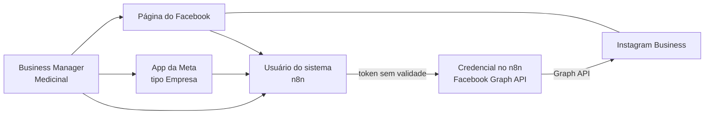

# 13 — Acesso ao Instagram (Graph API)

Parametrização para o n8n ler e publicar no Instagram da Medicinal. Atende o **M7 – Stories do Instagram** (Frente 6 em `docs/04-avaliacao-inicial.md`) e reaproveita o app da Meta da Frente 3 (Meta Ads).

**Situação em 22/10/2026:** o n8n ainda **não tem nenhuma credencial da Meta**. Nada foi configurado na Meta.

## Caminho escolhido

A Meta oferece duas formas de acesso. Usamos a **API do Instagram com login do Facebook** porque:
- serve também para Meta Ads e pixel (Frente 3), com um app só;
- aceita **token de usuário do sistema** do Business Manager, que não expira e não depende da senha de ninguém.

## Passo a passo (feito por quem é admin do Business Manager)

### 1. Conta do Instagram
- [ ] No app do Instagram: **Configurações → Tipo de conta → Conta profissional → Empresa**. Se já for Criador de conteúdo, também serve.
- [ ] Ligar o Instagram à **Página do Facebook** da Medicinal (Central de Contas ou configurações da Página → Contas vinculadas).

### 2. Business Manager (business.facebook.com)
- [ ] Confirmar que a **Página** e a **conta do Instagram** estão no Business Manager da Medicinal (Configurações → Contas → Páginas / Contas do Instagram).
- [ ] Anotar o **ID do Business Manager**. Não é segredo, pode vir para cá.
- [ ] Iniciar a **verificação da empresa** (Central de segurança). Ela não bloqueia o teste, mas é exigida para alguns acessos avançados e para anúncios.

### 3. App da Meta (developers.facebook.com)
- [ ] **Meus apps → Criar app**, tipo **Empresa**, com nome `Site Medicinal - n8n`, vinculado ao Business Manager da Medicinal.
- [ ] Adicionar os produtos **Instagram** (opção "API com login do Facebook") e **Marketing API**. O segundo só é preciso para a Frente 3.
- [ ] Preencher a URL da política de privacidade do site (exigência do app).
- [ ] Deixar o app **em modo de desenvolvimento** por enquanto. Como só vamos usar as contas da própria Medicinal, que estão no mesmo Business Manager, não é preciso passar pela Análise do app.

### 4. Usuário do sistema e token
- [ ] Business Manager → **Configurações → Usuários → Usuários do sistema → Adicionar**: nome `n8n`, função **Administrador**.
- [ ] **Atribuir ativos** a esse usuário:
  - Página do Facebook: controle total
  - Conta do Instagram: controle total
  - App `Site Medicinal - n8n`: controle total
- [ ] **Gerar token**: escolher o app, validade **Nunca** e as permissões abaixo.

| Permissão | Para quê |
|---|---|
| `instagram_basic` | ler perfil e mídias |
| `instagram_content_publish` | publicar feed e stories |
| `instagram_manage_insights` | métricas de posts e stories |
| `pages_show_list` | achar a Página e o Instagram ligado a ela |
| `pages_read_engagement` | ler dados da Página |
| `business_management` | acessar ativos do Business Manager |
| `ads_management`, `ads_read` | *(só para a Frente 3, Meta Ads)* |

Não marque `instagram_manage_comments` e `instagram_manage_messages` agora. Comentários e directs trazem dados pessoais (LGPD, regra 4).

### 5. Credencial no n8n
- [ ] n8n → **Credentials → Add → Facebook Graph API**.
- [ ] Nome: `Site Medicinal - Meta (Instagram)`.
- [ ] Colar o token **direto no n8n**. O token **nunca** vai para chat, e-mail, Notion ou este repositório (regra 5).
- [ ] Depois de criada, anotar aqui só o **ID da credencial**.

## App existente: `APP_clienteDM` (revisado em 22/10/2026)

Pelo print de **Configurações → Básico**:

| Campo | Situação | Ação |
|---|---|---|
| ID do app | 898730696565732 | ok |
| URL da política de privacidade | era `/politica-de-privacidade` (404) | ✅ trocada em 22/10/2026 por `https://www.medicinalnaweb.com.br/institucional/politica-de-privacidade` (responde 200) |
| Domínios do app | vazio | `medicinalnaweb.com.br` |
| Exclusão de dados do usuário | vazio | URL de instruções: a mesma página da política, se ela tiver uma seção de exclusão de dados (hoje não deixa isso claro), ou uma página própria |
| Categoria | vazio | Empresas e páginas |
| Ícone | vazio | logo da Medicinal (1024×1024) |
| Termos de serviço | vazio | opcional |

Os campos vazios só travam a passagem do app para o modo **Ao vivo**. Em modo de desenvolvimento, o teste já funciona.

O nome `APP_clienteDM` sugere que o app foi criado para **directs**. Decidir se reaproveitamos esse app (e renomeamos) ou criamos um separado. Directs têm dados pessoais (LGPD), por isso um app separado isola melhor as permissões.

Pelo print do **Painel**: o app está **Publicado** (modo Ao vivo) e tem o caso de uso **Gerenciar mensagens e conteúdo no Instagram** e o produto **Login do Facebook para Empresas**. O limite de volume está em 0% e o único alerta é informativo: o app passou para o modo publicado em 13/05/2026. A política de privacidade com 404 foi corrigida em 22/10/2026.

Pelo print de **Funções do app**: o app é gerenciado pelo Business Manager **Medicinal Farmácia E Manipulação**. Tem **1 administrador** (pessoa física) e a conta **@medicinalnaweb** como **Testador do Instagram**. Não há usuário do sistema nem desenvolvedor.
- Ter um só administrador é um risco: se essa pessoa sair, o app fica sem dono. Adicionar um segundo administrador pelo Meta Business Suite.
- A função de testador do Instagram indica a configuração **com login do Instagram**. O convite precisa estar **aceito** no app do Instagram (Configurações → Apps e sites → Convites de testador).

Pelo print de **Configurações → Avançado**: versão da Graph API **v25.0** (usar a mesma no n8n). Não há URL de callback para exclusão de dados, então a Meta pede que, de tempos em tempos, a lista de IDs do app seja baixada e esses registros sejam apagados. Como não guardamos dados de usuários do app, basta a URL de instruções de exclusão no Básico. "Descoberta social" está ligada e pode ser desligada: não tem uso para nós.

Seção **Segurança**: "Exigir chave secreta do aplicativo" está **desligado**, então o n8n só precisa do token (sem App Secret). Não há lista de IPs nem domínios definidos, e "Exigir reautorização de 2 fatores" está desligado (recomendado ligar). O **token de cliente** não deve ser copiado para chat, docs ou repositório.

### Caso de uso "Gerenciar mensagens e conteúdo no Instagram" (Personalizar)

O app usa a **API do Instagram com login do Instagram** (`graph.instagram.com`), não a com login do Facebook descrita no início deste doc. Para o M7 isso basta: publica feed e stories sem Página nem usuário do sistema.

| Etapa | Situação | O que fazer |
|---|---|---|
| 1. Permissões | ✅ `instagram_business_basic`, `instagram_business_manage_comments`, `instagram_business_manage_messages` | ✅ `instagram_business_content_publish` e `instagram_business_manage_insights` adicionadas em 22/10/2026 (acesso padrão) |
| 2. Gerar tokens | ✅ conta @medicinalnaweb adicionada; assinatura de webhook **Ativado** (não mexer) | Clicar em **Gerar token** e colar na credencial do n8n |
| 3. Webhooks | ✅ configurado (provavelmente para os directs) | **Não mexer** |
| 4. Login da empresa | ◐ | Não precisa: só usamos a conta da própria Medicinal |
| 5. Análise do app | ◐ | Não precisa: a conta tem função no app (testador), então o acesso padrão basta |

**Autorização da conta (22/10/2026):** no Instagram da @medicinalnaweb, em Apps e sites, o `APP_clienteDM-IG` aparece como **Vencida em 10/08/2026** (90 dias sem uso). Ou seja, o convite de testador já tinha sido aceito, mas o token antigo não vale mais. Gerar um token novo na etapa 2 reativa a autorização. Nenhum workflow com "Instagram" ou "DM" no nome foi encontrado no n8n.

**Diferenças em relação ao caminho com login do Facebook:**
- O token gerado no painel é **de longa duração (60 dias)** e precisa ser **renovado** antes de vencer (`GET https://graph.instagram.com/refresh_access_token?grant_type=ig_refresh_token`). Fica para um workflow próprio de renovação, ou lembrete a cada 50 dias.
- O token também carrega as permissões de comentários e directs que o app já tem. Os workflows do site **não chamam** esses endpoints (LGPD).
- **Pesquisa de hashtags** exige o login do Facebook. Os insights da conta e das mídias devem funcionar com `instagram_business_manage_insights`, mas o painel sugere trocar para o login do Facebook para "hashtags e insights": confirmado no teste de 22/10/2026 (`reach` diário).

**Credencial no n8n:** tipo **Query Auth**, nome do parâmetro `access_token`, nome `Site Medicinal - Instagram (token)`. Colar o token direto no n8n.

**Teste de acesso nesse caminho** (só `GET`, base `https://graph.instagram.com/v25.0`):

| # | Chamada | Confirma |
|---|---|---|
| 1 | `/me?fields=user_id,username,account_type,media_count` | token válido e conta Business |
| 2 | `/me/content_publishing_limit?fields=config,quota_usage` | permissão de publicação e cota de 24 h |
| 3 | `/me/media?fields=id,media_type,timestamp&limit=5` | leitura de mídias |
| 4 | `/me/insights?metric=reach&period=day` | permissão de insights |

Workflow `Site Medicinal - Teste de acesso Instagram (inativo)` (`UKhPnwvSom56JWEq`), gatilho manual, só `GET`.

**1ª execução (22/10/2026, nº 79983):** os 4 passos voltaram `Invalid OAuth 2.0 Access Token` (código 190). A credencial chega à API, mas o token não é aceito. Conferir na credencial: nome do parâmetro exatamente `access_token`; valor sem espaço, aspas ou quebra de linha; token do Instagram (começa com `IG`), não do Facebook (`EAA`); gerado depois das permissões novas.

**2ª execução (22/10/2026, nº 80054):** mesmo erro 190 nos 4 passos. O workflow está correto (credencial ligada nos 4 nós); o problema é o valor guardado na credencial.

**3ª execução (22/10/2026, nº 80055): ✅ acesso validado.**

| Passo | Resultado |
|---|---|
| 1. Conta | @medicinalnaweb, `BUSINESS`, `user_id` 17841401675469982, 1.813 mídias |
| 2. Cota de publicação | 100 publicações por 24 h, 0 usadas: **publicação liberada** |
| 3. Mídias | ok (5 últimas lidas) |
| 4. Insights | ok (`reach` diário): **insights funcionam com o login do Instagram** |

**Cuidado:** a resposta de `/me/media` traz `paging.next` com o `access_token` na URL, e o n8n grava isso no histórico da execução. O passo de mídias foi tirado do workflow de teste, e a execução 80055 deve ser apagada no n8n. Em qualquer workflow futuro que liste mídias, descartar o `paging` ainda no nó HTTP ou não salvar os dados da execução.

## O que vem para este doc (não é segredo)

| Item | Valor |
|---|---|
| Business Manager | Medicinal Farmácia E Manipulação (ID a preencher) |
| ID do app da Meta | 898730696565732 (`APP_clienteDM`, já existia) |
| ID do app do Instagram | 957953860481209 (`APP_clienteDM-IG`) |
| ID da Página do Facebook | _a preencher_ |
| ID da conta do Instagram (`ig-user-id`) | 17841401675469982 (painel, etapa 2). O 36005747902372344 visto em Apps e sites é o ID do usuário dentro do app |
| `@` do Instagram | medicinalnaweb |
| ID da credencial no n8n | `ZTNV44evExPBBMNC` (`Site Medicinal - Instagram (token)`, Query Auth) |

O **App Secret** e o **token** ficam fora desta tabela e fora do repositório.

## Teste de acesso (somente leitura)

Workflow `Site Medicinal - Teste de acesso Instagram (inativo)`, com gatilho manual e só chamadas `GET`. Ele usa a credencial acima.

| # | Chamada | Confirma |
|---|---|---|
| 1 | `GET /me?fields=id,name` | o token funciona |
| 2 | `GET /me/accounts?fields=id,name,instagram_business_account` | a Página está atribuída e mostra o `ig-user-id` |
| 3 | `GET /{ig-user-id}?fields=id,username,media_count,followers_count` | o Instagram é Business e está acessível |
| 4 | `GET /{ig-user-id}/content_publishing_limit?fields=config,quota_usage` | a permissão de publicação está ativa e mostra a cota de 24 h |
| 5 | `GET /{ig-user-id}/media?fields=id,media_type,timestamp&limit=5` | a leitura de mídias funciona |

O resultado do teste não deve trazer nome de seguidor, comentário ou direct.

## Publicação de story (depois do teste, com OK explícito)

1. A arte de 1080×1920 em JPEG fica numa **URL pública**, por exemplo num bucket público do Supabase como o do feed do Merchant.
2. `POST /{ig-user-id}/media` com `media_type=STORIES` e `image_url=<url>` (ou `video_url`) devolve um `creation_id`.
3. Para vídeo, esperar o processamento (`GET /{creation_id}?fields=status_code` até `FINISHED`).
4. `POST /{ig-user-id}/media_publish` com `creation_id=<id>` publica o story.

**Limitações a validar:** a API não coloca link sticker, enquete, música nem marcação de produto em story. Esses stories saem manualmente. Há também uma cota de publicações por 24 h, que o teste nº 4 mostra.

**Regra 6:** nenhum story real sai sem OK explícito. Até lá, o fluxo para na etapa 2 (container criado, não publicado).

## Publicação de stories

Workflow `Site Medicinal - Publicar story Instagram (inativo)` (`sNa5QuakTZd3gjYM`), com gatilho manual. O nó **Dados do story** recebe `image_url` (JPEG 1080×1920 em URL pública) e o nome da campanha. Depois vêm: criar o container (`media_type=STORIES`), aguardar 15 s, consultar o status e publicar (`media_publish`).

| Data | Campanha | Execução | Container | Mídia publicada |
|---|---|---|---|---|
| 22/10/2026 | Outubro Rosa 2026 (brindes: bloco e caneta; texto de conscientização, sem promessa de brinde) | 80318 | 18645263950055849 (`FINISHED`) | 17909203989327176 |

A arte foi montada a partir de uma foto dos brindes, com o fundo removido, e aprovada antes de publicar. A imagem ficou hospedada numa URL temporária do Runway. Para as próximas, usar um bucket público próprio (Supabase) para não depender de link com validade.
