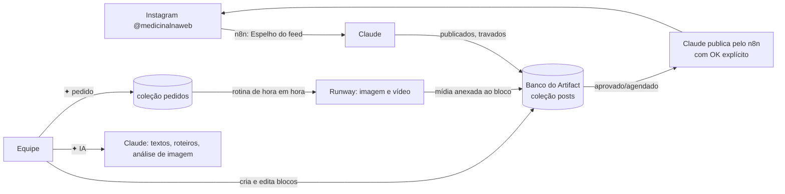
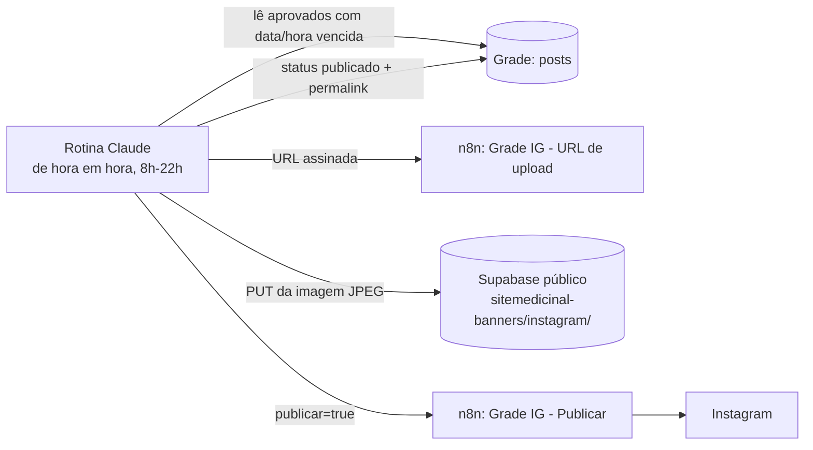

# 15 — Grade @medicinalnaweb (cronograma do Instagram)

Espelho do feed e dos stories do Instagram da Medicinal, usado para montar o cronograma. **Publicado fica travado**: o bloco passa a ser registro do que foi ao ar.

- **Onde:** Artifact https://claude.ai/artifact/Ayp1jCcyffTqZth63yXdtX (privado; compartilhar pelo menu Share). Mesma estratégia da aba Campanhas: roda como Artifact enquanto o portal não abre e depois migra para o PortalSiteMedicinal.
- **Fonte:** `grade/grade-instagram.html`.

## Telas
- **Feed:** cabeçalho de perfil e grade 3 colunas (4:5), mais recente primeiro. Tracejado = ainda não publicado.
- **Stories:** roleta de datas (de 21 dias atrás a 60 dias à frente, com bolinhas por story) e os stories do dia em 9:16.
- **Editor do bloco:** data, hora, formato, situação (Ideia → Rascunho → Aprovado), título, legenda, hashtags, mídia, roteiro de vídeo e histórico.

## IA em cada bloco
| Botão | Motor | Observação |
|---|---|---|
| Ajustar texto com IA (atalhos: mais curto, acolhedor, CTA site/WhatsApp, regras de saúde) | Claude (`sample`) | Proposta aparece para aceitar ou descartar |
| Escrever descrição com IA | Claude | Descrição da cena no padrão visual (doc 09): luz lateral, tons quentes + marinho, sem texto, sem embalagem, sem pessoa como profissional |
| Pedir imagem ao Runway | Rotina `pedidos de imagem e vídeo` (Runway `generate_image`, nano-banana-pro 2K, ~20 créditos) | Grava um pedido; a rotina gera, corta o feed para 4:5 (story 9:16) e anexa ao bloco. O status do pedido aparece no editor |
| Analisar imagem com IA | Claude com imagem | Combinação com o texto, regras de saúde e marca, nova descrição |
| Escrever roteiro com IA | Claude | Cenas com tempo, texto na tela e fala, no padrão visual |
| Pedir vídeo ao Runway | Mesma rotina (`generate_video`, seedance-2.5, 9:16, 720p) | Vídeo de ambiente. Embalagem e equipe só em gravação real. Vídeo é publicado à mão |

A página não chama mais conectores direto (Canva saiu em 10/11/2026: sem créditos e prompt fora do padrão). Imagem com produto e arte final com logo e fontes continuam com o Claude na conversa (doc 10).

Regras passadas à IA (constantes `REGRAS`, `LINHA` e `VISUAL` da página): PT-BR, tom direto; sem promessa de cura/efeito, sem antes e depois, sem medicamento sob prescrição como oferta, fechar com orientação profissional, sem dados de clientes; pirâmide de temas (doc 12) e gancho que polemiza o tema, nunca o resultado; padrão visual do 2º semestre de 2025 (doc 09).

## Dados
- Coleção `posts` (um documento por bloco): `canal` (feed/story), `formato`, `data`, `hora`, `status`, `titulo`, `legenda`, `hashtags`, `midia[]`, `prompt_imagem`, `roteiro_video`, `historico[]`; nos publicados também `ig_media_id`, `permalink`, `publicado_em`.
- Publicados são espelhados pelo Claude com id `ig_<media_id>`; as capas ficam guardadas no próprio Artifact (as URLs do Instagram expiram).
- Coleção `pedidos`: `bloco_id`, `tipo` (imagem/video), `prompt`, `canal`, `formato`, `status` (pendente → processando → pronto/erro), `task_id`, `asset_id`, `erro`, `criado_em`, `processando_em`, `concluido_em`.
- O travamento é feito pela página: "Publicado" não aparece no seletor e blocos publicados não abrem para edição nem exclusão.

## Espelho do Instagram (n8n, só leitura)
- `Site Medicinal - Espelho do feed Instagram (leitura)` (`7I7FHnyRbsaWaTvD`), manual: chama o sub-workflow abaixo.
- `Site Medicinal - Instagram mídias do feed (sub, sem histórico)` (`9xmnZPrHM0uLq924`): `GET /me/media` (18 últimas) e devolve só os campos das mídias. **Não guarda execuções** (a resposta da API traz o token na paginação).
- Carga inicial em 07/11/2026: 18 posts do feed (23/07 a 03/11/2026) e o story de Outubro Rosa (22/10/2026).

## Publicação a partir da grade (07/11/2026)

**Regra (Ricardo):** só vai ao ar o bloco com situação **Aprovado** e com **data e hora de postagem**. A página só deixa aprovar quando há data, hora, legenda (feed) e mídia certa (feed imagem = 1 imagem; carrossel = 2 a 10; story = 1 imagem). Reels e vídeo ainda saem à mão.

- Rotina `Grade @medicinalnaweb - publicação de blocos aprovados` (`trig_01ActqDM3WKFbTmso9xCSwbm`), `CRON_TZ=America/Sao_Paulo 1 8-22 * * *`, sessão nova a cada rodada, até 5 blocos por rodada. Trava o bloco (`publicando_em`) antes de publicar; em falha grava `erro_publicacao` (o bloco fica marcado "Falhou" e só volta à fila depois de editado e salvo).
- ⚠️ A rotina foi criada **sem o conector n8n** (o claude.ai não deixou repassar). Enquanto o conector não for adicionado à rotina em claude.ai → Rotinas, ela termina sem publicar nada.
- n8n (desativados, chamados pelo MCP em modo manual):
  - `Site Medicinal - Grade IG - URL de upload (inativo)` (`YUm9MkLzNIpC0BAz`): URL assinada do Supabase (uso único, 2 h), só para `instagram/*.jpg|png|mp4`.
  - `Site Medicinal - Grade IG - Publicar (inativo)` (`JzeSG0EOQRW58NmI`): feed imagem, carrossel ou story imagem; com `publicar=false` só cria o container (teste).
- Teste em 07/11/2026 (exec. 752955): container de feed criado (`FINISHED`) com imagem de teste e **não publicado**.

## Pedidos de imagem e vídeo (10/11/2026)
- Rotina `Grade @medicinalnaweb - pedidos de imagem e vídeo (Runway)` (`trig_01BXAxUbfjXqbQ7Le6Ha8tjd`), `CRON_TZ=America/Sao_Paulo 31 8-22 * * *`, sessão nova a cada rodada; até 3 imagens e 1 vídeo por rodada. Só gera e anexa; nunca publica nem muda a situação do bloco.
- ⚠️ Criada **sem o conector Runway** (o claude.ai não deixa repassar conectores pela ferramenta). Até o Ricardo adicionar o Runway à rotina em claude.ai, ela termina com "Rotina sem acesso ao Runway".
- Se o editor do bloco estiver aberto quando a mídia chegar, feche e abra de novo antes de salvar (salvar com o editor antigo descarta a mídia recém-anexada).

## Próximos passos
2. Atualização periódica do espelho (stories somem em 24 h na API: espelhar no dia).
3. Migrar para o PortalSiteMedicinal quando o endereço voltar.

## Semana de teste 09–15/11/2026 (gerada em 07/11)

24 blocos em **Rascunho**, para revisar e aprovar na grade:
- **Feed (18h):** seg 09/11 Peptistrong (carrossel, pilar "fava: proteína vegetal"), qua 11/11 Maxsolve (CoQ10 em gotas, imagem), sex 13/11 PeptiPump (carrossel, sem estimulante).
- **Stories:** 3 por dia (9h, 13h, 19h), seguindo os pilares do Peptistrong diário da semana (`docs/04-peptistrong-black-friday.md`), mais apoio aos posts do feed e institucional (ISO 9001, orientação farmacêutica).
- Fontes dos textos: copy do E3 (Peptistrong), post do PeptiPump já publicado em 30/07 e descrição pública do Maxsolve (Coenzima Q10 em nanoemulsão). Maxsolve e PeptiPump são **insumos do FC** (14124 e 17267), sem página no site: chamada para o WhatsApp.
- Artes geradas por script (v1: `grade/semana-2026-11-09/gera.py` + `pecas.json`; v2 atual: `gera2.py` + `pecas2.json`), folhas de contato na mesma pasta.
- **Revisão farmacêutica** antes de aprovar, principalmente Maxsolve (dose) e PeptiPump.

### Identidade visual v2 (07/11/2026)
- Padrão **azul-marinho, branco e cinza**: foto em cima, faixa da marca em azul-marinho, texto embaixo em fundo branco. Gerador: `semana-2026-11-09/gera2.py` + `pecas2.json`.
- Fotos: 12 imagens geradas no **Runway** (sessão auxiliar), em `semana-2026-11-09/fotos/`, reaproveitadas entre os blocos. Pessoas sempre de costas, sem texto nem logo.
- Os créditos de IA do **Canva** acabaram em 07/11 depois de 4 imagens; o botão "Gerar imagem no Canva" da grade falha até renovar.
- Os 24 blocos da semana receberam as artes novas (continuam em Rascunho).
