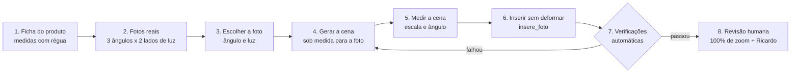

# 10 — Procedimento: inserção de produto em cena gerada por IA

**Obrigatório** para toda arte que mostra uma embalagem real dentro de uma cena gerada por IA. Criado em 08/11/2026 depois do teste com o Peptistrong (três versões reprovadas: lata colada, grande demais, tampa alterada, baixa demais). Complementa a seção 12 do `09-padrao-visual.md`.

Princípio: **a embalagem é fato, a cena é ficção.** A cena se adapta ao produto; o produto nunca se adapta à cena.

## 1. Ficha do produto (uma vez por produto)

Arquivo `grade/produtos/<produto>.json` (modelo: `peptistrong.json`).

- **Medir com régua**: altura total com tampa, diâmetro (ou largura × profundidade), diâmetro da tampa. Em cm, uma casa decimal.
- Registrar quem mediu e quando.
- A proporção usada na arte sai **daqui**, nunca de mockup nem de estimativa em foto.

## 2. Fotos reais do produto (uma vez por produto)

Feitas na loja, com celular, **fundo liso** (cartolina off-white ou cinza), sem flash, luz de janela.

| Ângulo da câmera | Altura da câmera | Luz da janela pela esquerda | Luz da janela pela direita |
|---|---|---|---|
| Frontal | meio da embalagem | foto 1 | foto 2 |
| **≈ 20° de cima (prioridade)** | um pouco acima da tampa | foto 1b | foto 2b |
| 30° de cima | um palmo acima da tampa | foto 3 | foto 4 |
| 60° de cima | bem acima, quase de cima | foto 5 | foto 6 |

- Rótulo virado de frente, sem reflexo cobrindo o texto, tampa e alça na posição de uso.
- Uma régua ou um objeto padrão (copo americano) ao lado em uma foto extra, para conferir a proporção.
- Guardar em `grade/produtos/<produto>/` e registrar na ficha a **razão da elipse da tampa** de cada foto (`razao_elipse`).
- **Proibido:** mockup 3D, render do fabricante, foto de banco, embalagem gerada por IA.

## 3. Escolher a foto do produto

A peça começa pelo produto: escolher a foto (ângulo e lado da luz) que serve à ideia da arte. Essa escolha define a câmera e a luz da cena.

## 4. Gerar a cena sob medida

O prompt da cena descreve **a câmera e a luz da foto escolhida**:

- altura e ângulo da câmera ("camera at eye level with the countertop", "camera 30 degrees above"),
- lado e cor da luz ("warm window light from the left"),
- **objeto de referência de tamanho conhecido** na mesma profundidade onde o produto vai ficar (copo americano 190 ml ≈ 9,5 cm de altura; caneca; mão),
- **espaço vazio** na superfície onde o produto vai entrar,
- "no packaging, no products, no text, no logos".

Gerar a cena **sem** o produto. Nunca pedir à IA para desenhar a embalagem.

## 5. Medir a cena

1. **Escala** (`px_por_cm`): medir em px a altura do objeto de referência e dividir pela altura real em cm.
2. **Ângulo** (`razao_elipse`): medir a elipse da boca do copo ou da tigela.
3. **Conferir com a foto do produto**: a razão da elipse da cena e a da tampa na foto escolhida devem diferir **no máximo 0,03**. Se diferir mais: trocar a foto do produto (outro ângulo) ou gerar a cena de novo. **Nunca deformar a embalagem para compensar.**
4. **Luz**: o lado claro do produto na foto tem que estar do mesmo lado da janela da cena. Se não estiver, trocar a foto (a do outro lado da luz). Nunca espelhar a imagem (o texto inverte).

## 6. Inserir

`grade/insere_produto.py` → `insere_foto(cena, recorte, base_centro, largura_corpo)`:

- `largura_corpo` = diâmetro real (cm, da ficha) × `px_por_cm` da cena. Altura sai da proporção da foto.
- `curvatura_extra = 0` (sem deformar).
- Ajustes permitidos: exposição e cor **globais** do produto para casar com a cena, sombra de contato, sombra projetada para o lado oposto à luz, manchas de luz da cena, borda (light wrap), grão e desfoque iguais aos da cena.
- **Contato com a superfície (obrigatório):**
  - A sombra de contato segue a **pegada** da embalagem: uma elipse com a mesma curvatura da borda de baixo (`base_arco` = altura do arco da base ÷ altura do recorte). Nas pontas, o arco sobe, e a sombra sobe junto. Uma sombra "deitada" só embaixo do centro deixa as laterais flutuando.
  - A parte de baixo do próprio produto escurece perto da superfície (`base_escurece`, `base_faixa`).
  - O recorte não pode ter degrau nos cantos de baixo: o corpo vai só até o centro da elipse da base.
  - Conferir com zoom na base: não pode sobrar superfície iluminada entre a borda e a sombra.
- **Não permitido:** redesenhar tampa, alça, rótulo ou qualquer parte da embalagem; alterar proporção; espelhar.

**Reiluminação (recomendada):** `grade/iclight.py` → `reilumina` (IC-Light, luz do lado da janela da cena) e depois `aplica_luz` sobre a foto original **antes** do recorte e da inserção. Só a luz muda; os pixels do rótulo continuam os da foto. Força entre 0,5 e 0,7.

**Harmonização por IA (opcional):** só da cena ao redor. Depois dela, os pixels da embalagem voltam da foto original (máscara) e passam pela verificação. No teste, a IA trocou "TECNOLÓGICA" por "TEENOUÓSICA" e redesenhou a tampa.

## 7. Verificações automáticas (todas obrigatórias)

| Verificação | Como | Aprova se |
|---|---|---|
| **Fidelidade da embalagem** | `verifica_fidelidade(arte, recorte, caixa)`: correlação dos detalhes (letras, logo, bordas) entre a arte e a foto original | **≥ 0,90**. Referência do teste: lata real inserida = 0,937; rótulo reescrito pela IA = 0,009 |
| **Escala** | altura do produto em px ÷ `px_por_cm` | dentro de **±3%** da altura real da ficha |
| **Proporção** | largura ÷ altura do produto na arte | igual à da ficha, **±2%** |
| **Ângulo** | razão da elipse da cena × da foto do produto | diferença **≤ 0,03** |
| **Luz** | lado claro do produto × lado da janela | mesmo lado |

## 8. Revisão humana

- Ver a arte em **100% de zoom** na região do produto: tampa, alça, base, sombra e texto.
- Ver no tamanho do feed (celular): o produto tem que passar despercebido como foto.
- **Aprovação do Ricardo.** Na dúvida, a arte não sai.

## Registro do teste de 08/11/2026

| Versão | Problema | Lição |
|---|---|---|
| 1 | lata do mockup grande, sem perspectiva, sem sombra | escala por objeto de referência; sombras |
| 2 | mockup com proporção errada (mais alto e fino que a real) | medir o produto real; não usar mockup |
| 3 | harmonização por IA reescreveu o rótulo e a tampa | IA nunca nos pixels da embalagem; verificação automática |
| 4 | foto real com câmera na altura da lata em cena vista de cima; luz do lado oposto | a cena é gerada para a foto do produto, não o contrário |

| 5 | foto real reiluminada (IC-Light) em cena sob medida: fidelidade 0,957, luz e proporção ok; ângulo reprovado (cena ≈ 0,10–0,16 × foto ≈ 0,05) | geradores de imagem fazem câmera levemente de cima; a foto de ~30° de cima é a mais útil |

Pendente para a 1ª arte aprovada: **medidas com régua e as 6 fotos do Peptistrong** (seção 2).
