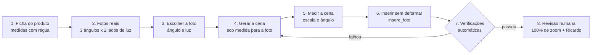

# 10 — Procedimento: inserção de produto em cena gerada por IA

**Obrigatório** para toda arte que mostra uma embalagem real dentro de uma cena gerada por IA. Criado em 08/11/2026 depois do teste com o Peptistrong (três versões reprovadas: lata colada, grande demais, tampa alterada, baixa demais). Complementa a seção 12 do `09-padrao-visual.md`.

Princípio: **a embalagem é fato, a cena é ficção.** A cena se adapta ao produto; o produto nunca se adapta à cena.



## 1. Ficha do produto (uma vez por produto)

Arquivo `grade/produtos/<produto>.json` (modelo: `peptistrong.json`).

- **Medir com régua**: altura total com tampa, diâmetro (ou largura × profundidade), diâmetro da tampa. Em cm, uma casa decimal.
- Registrar quem mediu e quando.
- A proporção usada na arte sai **daqui**, nunca de mockup nem de estimativa em foto.

## 2. Fotos reais do produto (uma vez por produto)

Feitas na loja, com celular, **fundo liso** (cartolina off-white ou cinza), sem flash, luz de janela.

| Ângulo da câmera | Altura da câmera | Luz da janela pela esquerda | Luz da janela pela direita |
|---|---|---|---|
| Frontal | meio da embalagem | foto 1 | foto 2 |
| **≈ 20° de cima (prioridade)** | um pouco acima da tampa | foto 1b | foto 2b |
| 30° de cima | um palmo acima da tampa | foto 3 | foto 4 |
| 60° de cima | bem acima, quase de cima | foto 5 | foto 6 |

- Rótulo virado de frente, sem reflexo cobrindo o texto, tampa e alça na posição de uso.
- Uma régua ou um objeto padrão (copo americano) ao lado em uma foto extra, para conferir a proporção.
- Guardar em `grade/produtos/<produto>/` e registrar na ficha a **razão da elipse da tampa** de cada foto (`razao_elipse`).
- **Proibido:** mockup 3D, render do fabricante, foto de banco, embalagem gerada por IA.

## 3. Escolher a foto do produto

A peça começa pelo produto: escolher a foto (ângulo e lado da luz) que serve à ideia da arte. Essa escolha define a câmera e a luz da cena.

## 4. Gerar a cena sob medida

O prompt da cena descreve **a câmera e a luz da foto escolhida**:

- altura e ângulo da câmera ("camera at eye level with the countertop", "camera 30 degrees above"),
- lado e cor da luz ("warm window light from the left"),
- **objeto de referência de tamanho conhecido** na mesma profundidade onde o produto vai ficar (copo americano 190 ml ≈ 9,5 cm de altura; caneca; mão),
- **espaço vazio** na superfície onde o produto vai entrar,
- "no packaging, no products, no text, no logos".

Gerar a cena **sem** o produto. Nunca pedir à IA para desenhar a embalagem.

## 5. Medir a cena

1. **Escala** (`px_por_cm`): medir em px a altura do objeto de referência e dividir pela altura real em cm.
2. **Ângulo** (`razao_elipse`): medir a elipse da boca do copo ou da tigela.
3. **Conferir com a foto do produto**: a razão da elipse da cena e a da tampa na foto escolhida devem diferir **no máximo 0,03**. Se diferir mais: trocar a foto do produto (outro ângulo) ou gerar a cena de novo. **Nunca deformar a embalagem para compensar.**
4. **Luz**: o lado claro do produto na foto tem que estar do mesmo lado da janela da cena. Se não estiver, trocar a foto (a do outro lado da luz). Nunca espelhar a imagem (o texto inverte).

## 6. Inserir

`grade/insere_produto.py` → `insere_foto(cena, recorte, base_centro, largura_corpo)`:

- `largura_corpo` = diâmetro real (cm, da ficha) × `px_por_cm` da cena. Altura sai da proporção da foto.
- `curvatura_extra = 0` (sem deformar).
- Ajustes permitidos: exposição e cor **globais** do produto para casar com a cena, sombra de contato, sombra projetada para o lado oposto à luz, manchas de luz da cena, borda (light wrap), grão e desfoque iguais aos da cena.
- **Contato com a superfície (obrigatório):**
  - A sombra de contato segue a **pegada** da embalagem: uma elipse com a mesma curvatura da borda de baixo (`base_arco` = altura do arco da base ÷ altura do recorte). Nas pontas, o arco sobe, e a sombra sobe junto. Uma sombra "deitada" só embaixo do centro deixa as laterais flutuando.
  - A parte de baixo do próprio produto escurece perto da superfície (`base_escurece`, `base_faixa`).
  - O recorte não pode ter degrau nos cantos de baixo: o corpo vai só até o centro da elipse da base.
  - Conferir com zoom na base: não pode sobrar superfície iluminada entre a borda e a sombra.
- **Não permitido:** redesenhar tampa, alça, rótulo ou qualquer parte da embalagem; alterar proporção; espelhar.

**Reiluminação (recomendada):** `grade/iclight.py` → `reilumina` (IC-Light, luz do lado da janela da cena) e depois `aplica_luz` sobre a foto original **antes** do recorte e da inserção. Só a luz muda; os pixels do rótulo continuam os da foto. Força entre 0,5 e 0,7.

**Harmonização por IA (opcional):** só da cena ao redor. Depois dela, os pixels da embalagem voltam da foto original (máscara) e passam pela verificação. No teste, a IA trocou "TECNOLÓGICA" por "TEENOUÓSICA" e redesenhou a tampa.

## 7. Verificações automáticas (todas obrigatórias)

| Verificação | Como | Aprova se |
|---|---|---|
| **Fidelidade da embalagem** | `verifica_fidelidade(arte, recorte, caixa)`: correlação dos detalhes (letras, logo, bordas) entre a arte e a foto original | **≥ 0,90**. Referência do teste: lata real inserida = 0,937; rótulo reescrito pela IA = 0,009 |
| **Escala** | altura do produto em px ÷ `px_por_cm` | dentro de **±3%** da altura real da ficha |
| **Proporção** | largura ÷ altura do produto na arte | igual à da ficha, **±2%** |
| **Ângulo** | razão da elipse da cena × da foto do produto | diferença **≤ 0,03** |
| **Luz** | lado claro do produto × lado da janela | mesmo lado |

## 7b. Catálogo de erros (todos aconteceram nos testes de 08/11/2026)

Cada erro tem causa, prevenção e como é verificado. **A arte só segue se nenhum erro do catálogo aparecer.**

| # | Erro | Como aparece | Causa | Prevenção | Verificação |
|---|---|---|---|---|---|
| 1 | **Produto grande ou pequeno demais** | a lata domina ou some perto do copo | escala no olho | escala pelo objeto de referência (`px_por_cm`) + medida real da ficha | automática: escala ±3% |
| 2 | **Proporção errada** | lata alta e fina demais | mockup/render com proporção diferente da embalagem real | usar só **foto real**; proporção da ficha | automática: proporção ±2% |
| 3 | **Ângulo incompatível** | tampa "chapada" (linha) enquanto se vê a boca do copo | foto do produto com câmera mais baixa que a da cena | escolher a foto do ângulo da cena; a IA quase sempre gera câmera levemente de cima → usar a foto **20–30° de cima** | automática: elipse ±0,03 |
| 4 | **Luz do lado errado** | lado claro do produto oposto à janela | foto do produto com luz de outro lado | foto com luz do mesmo lado ou IC-Light (`reilumina` + `aplica_luz`) | visual + checklist |
| 5 | **Rótulo/tampa alterados pela IA** | letras trocadas ("TEENOUÓSICA"), tampa redesenhada | geração ou harmonização por IA sobre a embalagem | IA **nunca** nos pixels da embalagem; só mapa de luz | automática: fidelidade ≥ 0,90 |
| 6 | **Produto flutuando** | superfície iluminada logo abaixo da base | sem sombra de contato | sombra de contato + base do produto escurecida (`base_escurece`) | automática: contato ≥ 0,30 em 7 pontos |
| 7 | **Laterais flutuando** | pontas da base "soltas" | sombra deitada só sob o centro | sombra pela **pegada** (elipse com o arco da base, `base_arco`) | automática: contato inclui as laterais |
| 8 | **Degrau no recorte** | cantinhos quadrados embaixo | retângulo do corpo passando da elipse da base | corpo só até o centro da elipse da base | visual: zoom 2 e 3 |
| 9 | **Fundo da foto original grudado** | bloco claro junto da alça, cantos com fundo sob a tampa | recorte por limiar de cor ou contorno maior que a peça | contorno **desenhado à mão** sobre a foto ampliada, com vãos abertos (alça) e cada parte na largura real | visual: zoom 1 e 4 (**não detectável automaticamente** quando grudado na peça) |
| 10 | **Linha ou forma solta** | traço branco acima da tampa | elemento desenhado sem necessidade (topo extra com curvatura 0) | não desenhar nada que não esteja na foto | visual: zoom 1 + `verifica_mascara` (ilhas) |
| 11 | **Contorno retangular / cantos vivos na tampa** | moldura fina nos cantos do topo | contorno retangular onde a peça é elíptica | contorno com a forma real (elipse do topo + lateral) | visual: zoom 1; automática: halo ≤ 18 |
| 12 | **Emenda de cor** | faixa com tom diferente no meio do produto | correção de cor aplicada com corte reto | correções só na área da peça, com transição suave (desfoque) | visual: zoom 1 |
| 13 | **Ruído / chiado** | superfície lisa (tampa branca) granulada | grão fixo, mais forte que o da cena | grão **medido na cena** perto do produto (`grao=None`) | visual: zoom 1 |
| 14 | **Branco acinzentado / preto amarronzado** | tampa apagada, rótulo marrom | multiplicação de cor/luz que clareia o preto ou escurece o branco | ganho por curva que preserva pretos; branco da tampa volta ao tom real | visual: tamanho do feed |
| 15 | **Sombra incoerente** | sombra do produto em direção ou força diferente das sombras da cena | sombra no padrão, sem olhar a cena | medir direção, comprimento e força das sombras vizinhas e repetir | visual: tamanho do feed |
| 16 | **Cena que não obedece ao pedido** | IA ignora "câmera rente", cria sombras contraditórias | limitação dos geradores | não insistir: trocar a foto do produto pela do ângulo que a IA gera | medir a cena antes de inserir |

**Ferramentas:** `grade/insere_produto.py` → `verifica_fidelidade`, `verifica_mascara`, `verifica_contato`, `verifica_halo`, `folha_inspecao`. Recorte de cada produto em `grade/produtos/<produto>/recorte.py` (contornos à mão, versionados).

**Testes de controle** (as verificações reprovam o erro de verdade): rótulo reescrito pela IA → fidelidade 0,009; lata sem sombra de contato → contato 0,04–0,05.

## 7c. Procedimento de validação (obrigatório antes da revisão humana)

Um comando valida tudo e **reprova sozinho** se qualquer item falhar:

```bash
python3 grade/valida_insercao.py <pasta>/ficha_insercao.json
```

Gera `<saida>_validacao.md` (tabela de resultados + checklist visual) e `<saida>_inspecao.jpg` (folha de inspeção). Código de saída 1 = reprovado. Exemplo completo: `grade/teste-padrao-2025/ia/v5/`.

### Passo 1: medir e preencher a ficha da inserção (`ficha_insercao.json`)

| Campo | O que é | Como medir |
|---|---|---|
| `produto.altura_cm` | altura real com tampa | **régua** (ficha do produto). Vazio = reprova |
| `produto.proporcao_corpo_altura` | largura do corpo ÷ altura total | na foto real de referência |
| `produto.elipse_foto` | razão da elipse da tampa/boca na foto do produto | `razao_elipse` na foto |
| `produto.base_arco` | altura do arco da borda de baixo ÷ altura do recorte | no recorte |
| `cena_medidas.ref_altura_cm` / `ref_altura_px` | objeto de referência (copo, caneca) na mesma profundidade | altura conhecida × px medidos na cena |
| `cena_medidas.elipse_cena` | razão da elipse da boca do copo/tigela na cena | `razao_elipse` na cena |
| `cena_medidas.luz_lado` | lado da janela/fonte de luz | `esquerda` ou `direita` |
| `cena_medidas.vizinho_borda_caixa` | caixa estreita sobre a borda de um objeto vizinho na mesma profundidade | para comparar nitidez |
| `colocacao.caixa` / `corpo_x` / `base_y` | onde o recorte ficou na arte | saem da chamada de `insere_foto` |

### Passo 2: verificações automáticas e limites

| Grupo | Verificação | Limite | Pega o erro nº (7b) |
|---|---|---|---|
| Geometria | Escala (altura medida × esperada pela referência) | ±3% | 1 |
| Geometria | Proporção largura/altura × real | ±2% | 2 |
| Geometria | Ângulo: elipse da cena × elipse da foto | diferença ≤ 0,03 | 3 |
| Embalagem | Fidelidade do rótulo e da forma | ≥ 0,90 | 5 |
| Bordas | Recorte em uma peça, sem ilhas, borda semitransparente ≤ 6% | — | 9, 10 |
| Bordas | Halo claro na borda | ≤ 18 | 11 |
| Bordas | Nitidez da borda × objeto vizinho | 0,5 a 2,0 | 5 (borda borrada ou recortada demais) |
| Contato | Sombra de contato em 7 pontos da pegada, laterais incluídas | escurece ≥ 30% em todos | 6, 7 |
| Contato | Sombra projetada do lado oposto à luz | escurece ≥ 8% | 15 |
| Luz | Lado da janela mais claro no produto | ≥ +4% | 4 |
| Luz | Pretos do produto × pretos da cena | produto ≤ cena + 25 | 14 |
| Acabamento | Grão do produto × grão da cena, só em áreas lisas | 0,6 a 1,6 | 13 |

**Controles negativos já testados** (o validador reprova o erro de verdade): rótulo reescrito pela IA → fidelidade 0,009; lata sem contato → 0,04; grão exagerado → 6,00.

### Passo 3: revisão visual na folha de inspeção

O que a máquina não mede bem fica no checklist do relatório: forma da tampa e do topo, acessórios (vãos e fundo grudado), degrau na base, emenda de cor, coerência das sombras com as da cena e a impressão geral no tamanho do feed.

### Passo 4: aprovação

Só depois de **todos os ✅ automáticos + checklist visual completo**, a arte vai para o Ricardo.

## 8. Revisão humana

- Abrir a **folha de inspeção** (`folha_inspecao`): 4 zooms (topo/tampa, base/contato, lado esquerdo, lado direito/acessórios) + tamanho do feed + resultado das verificações. Percorrer o catálogo de erros (seção 7b) em cada zoom.
- Ver no tamanho do feed (celular): o produto tem que passar despercebido como foto.
- **Aprovação do Ricardo.** Na dúvida, a arte não sai.

## Registro do teste de 08/11/2026

| Versão | Problema | Lição |
|---|---|---|
| 1 | lata do mockup grande, sem perspectiva, sem sombra | escala por objeto de referência; sombras |
| 2 | mockup com proporção errada (mais alto e fino que a real) | medir o produto real; não usar mockup |
| 3 | harmonização por IA reescreveu o rótulo e a tampa | IA nunca nos pixels da embalagem; verificação automática |
| 4 | foto real com câmera na altura da lata em cena vista de cima; luz do lado oposto | a cena é gerada para a foto do produto, não o contrário |

| 5 | foto real reiluminada (IC-Light) em cena sob medida: fidelidade 0,957, luz e proporção ok; ângulo reprovado (cena ≈ 0,10–0,16 × foto ≈ 0,05) | geradores de imagem fazem câmera levemente de cima; a foto de ~30° de cima é a mais útil |

Pendente para a 1ª arte aprovada: **medidas com régua e as 6 fotos do Peptistrong** (seção 2).
