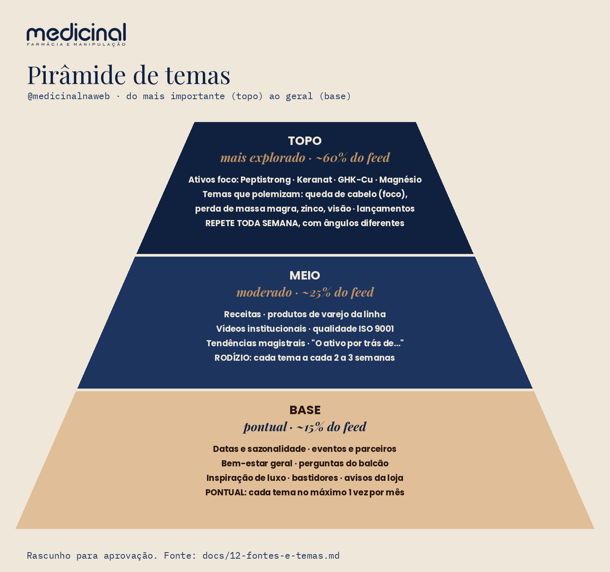

# 12 — Fontes de informação e temas para conteúdo (documento vivo)

Criado em 08/11/2026 a pedido do Ricardo. **Atualizar sempre que uma fonte for coletada, um tema virar pauta ou um tema novo surgir** (registro no fim do arquivo).

Tudo o que sai daqui passa pelas regras do projeto: sem dados de clientes (LGPD), sem alegação de cura ou efeito, sem medicamento sob prescrição como oferta, revisão farmacêutica antes de aprovar (`CLAUDE.md`, `09-padrao-visual.md` seção 13).

## 0. Pirâmide de temas (prioridade)

Pedido do Ricardo em 08/11/2026: temas mais importantes no topo, intermediários no meio e gerais na base. **Rascunho para aprovação.**

| Camada | Temas | Peso no feed | Numa semana de 4 a 5 posts | Repetição de cada tema |
|---|---|---|---|---|
| **Topo**: mais explorado | Ativos foco (Peptistrong, Keranat, GHK-Cu, **magnésio**) · temas que polemizam (queda de cabelo em foco, perda de massa magra, zinco, visão) · lançamentos | **~60%** | **3 posts** | **toda semana**, sempre com ângulo e formato diferentes (regras da 2.0) |
| **Meio**: moderado | Receitas com produtos da linha (2.8) · produtos de varejo (2.6) · vídeos institucionais (2.7) · tendências magistrais e "O ativo por trás de…" (2.2, 2.3) | **~25%** | **1 post** | **rodízio**: cada tema volta a cada 2 a 3 semanas |
| **Base**: pontual | Datas e sazonalidade · eventos e parceiros · bem-estar geral · perguntas do balcão · inspiração de luxo · bastidores do dia a dia · avisos da loja | **~15%** | **0 a 1 post** (às vezes só stories) | **no máximo 1 vez por mês** cada tema; não repetir |

Pedido do Ricardo em 08/11/2026: **explorar mais o topo e menos o meio e a base**. Como o meio e a base têm muitos temas, cada um aparece pouco e sem repetição. Quem se repete é o topo.

**Como usar:**
- Toda grade semanal é montada **de cima para baixo**: primeiro os posts do topo, depois os do meio e, por último, a base.
- Um tema pode cumprir duas camadas. Uma receita com Peptistrong, por exemplo, é meio (receita) **e** topo (ativo foco); conta para o topo.
- Os **stories** seguem a mesma pirâmide, mas sustentam principalmente o topo: enquetes e perguntas sobre os ativos foco.
- Revisar a pirâmide **todo mês** com os números do perfil (F7) e os mais vendidos (F1).

## 1. Fontes de informação

| # | Fonte | O que extrair | Como coletar | Frequência | Situação |
|---|---|---|---|---|---|
| F1 | **Mais vendidos da Medicinal** (FCerta, tabela `FC12110`, Firebird) | ranking de produtos e fórmulas por quantidade e faturamento, por mês; sazonalidade; o que cresce e o que cai | workflow novo no n8n `Site Medicinal - Instagram: mais vendidos (leitura)`, desativado, gatilho manual, **só `SELECT`** com filtro por data e `FIRST n`, **na réplica**. Agregado por produto, **sem cliente, sem receita, sem prescritor** | mensal | ⏳ a fazer. Falta confirmar a réplica e o OK do Ricardo |
| F2 | **Produtos do site** (www.medicinalnaweb.com.br, VTEX) | catálogo ativo, categorias, preços, fotos oficiais, textos de produto, o que tem link para comprar | API pública de catálogo da VTEX (leitura) ou planilha do repositório `site-medicinalnaweb` | mensal | ⏳ a fazer |
| F3 | **Tendências do mercado magistral** | ativos novos e em alta (ex.: GHK-Cu, PDRN, peptídeos, exossomos, ativos de skincare coreano), lançamentos de fornecedores | feiras e eventos (Consulfarma, Endo Academy), materiais de fornecedores (Galena, Fagron, Purifarma, Infinity), Google Trends, Ahrefs (volume de busca) | mensal | ⏳ a fazer |
| F4 | **Instagram de referência** (outras farmácias) | formatos que engajam, temas, frequência, ganchos, o que os seguidores perguntam nos comentários (só o tema, sem nome de pessoa) | perfis: **@oficialfarma**, **@essentiapharma**, **@farmaciavitacora** (confirmar os @ exatos). Leitura pública via API do Instagram (business discovery) com o token de anúncios, ou Supermetrics (Instagram Public Data) | quinzenal | ⏳ a fazer. Confirmar os @ |
| F5 | **Cosméticos de referência × ativo manipulado** | composição (INCI) de produtos conhecidos e quais ativos dela a Medicinal manipula | lista INCI publicada pela marca + ficha técnica do ativo do fornecedor | por pauta | ⏳ a fazer |
| F6 | **Tendências de luxo** | o que marcas de luxo estão usando (ativos, rituais, embalagens, linguagem) e que tem ligação com produtos da Medicinal | publicações de beleza e bem-estar, lançamentos de marcas premium, relatórios de tendência | mensal | ⏳ a fazer |
| F7 | **Desempenho do próprio perfil** | o que engajou em 2024, 2025 e 2026 | workflow `Site Medicinal - Instagram posts desde 2024 (leitura)` | mensal | ✅ feito em 08/11 (`docs/06`, `07` e `08`) |
| F8 | **Buscas no Google** | o que as pessoas procuram sobre os temas foco em Maringá e no Brasil | Ahrefs (palavras-chave e Search Console do site) | mensal | ⏳ a fazer |
| F9 | **Perguntas do balcão e do WhatsApp** | dúvidas que se repetem, só o tema e a contagem | a equipe anota numa lista **sem nome, telefone ou dado de saúde da pessoa** | semanal | ⏳ combinar com a equipe |
| F10 | **Datas e sazonalidade** | verão (cabelo e pele, proteção), volta às aulas, Outubro Rosa, Novembro Azul, Black Friday, Dia das Mães, inverno (imunidade) | calendário anual | anual | ⏳ montar o calendário 2027 |

### Regras por fonte

- **F1 (Firebird):** regras do projeto do site. Workflow novo, desativado, só `SELECT`, com filtro de data, `FIRST n` e na réplica. Nada roda contra a produção sem o OK do Ricardo. O resultado entra no repositório só **agregado por produto**.
- **F4 (concorrentes):** observar **formato e tema**, nunca copiar texto, arte ou foto. Não citar nem marcar os perfis nos posts.
- **F5 (comparação com marcas):** pode citar a composição pública (INCI) e dizer que o ativo também é manipulado. **Não pode** afirmar que o manipulado "é igual" ou "funciona como" o produto de marca, nem depreciar a marca. Isso vale para cosmético; para medicamento, comparação é proibida. Revisão farmacêutica obrigatória.
- **F6 (luxo):** usar o universo de luxo (ritual, sensorialidade, ativo nobre) como **inspiração de linguagem e de estética**, sem usar marca de terceiros na arte.

## 2. Temas

### 2.0 Ativos foco (repetição planejada no feed e nos stories)

Pedido do Ricardo em 08/11/2026: alguns ativos precisam ser trabalhados **com mais insistência**, aparecendo de forma repetida no feed e nos stories até virarem referência do perfil. A repetição é **planejada**: o mesmo ativo volta com **ângulos e formatos diferentes**, nunca com o mesmo post de novo.

**Lista de ativos foco (a confirmar pelo Ricardo):**

| Ativo / produto | Por que é foco | Tema foco ligado | Meta por semana | Situação |
|---|---|---|---|---|
| **Peptistrong** | produto que mais rendeu conteúdo em 2025 e 2026; campanha de novembro | perda de massa magra | 1 feed + 3 stories | a confirmar |
| **Keranat** | "5 motivos para tomar Keranat" teve 109 interações em 2026 | queda de cabelo | 1 feed + 3 stories | a confirmar |
| **GHK-Cu** | tendência do mercado magistral e do luxo | pele / longevidade | 1 feed a cada 15 dias + 2 stories por semana | a confirmar |
| **Magnésio** | definido pelo Ricardo como tema do topo (08/11/2026); a linha já tem magnésio treonato (post de 04/2026) | sono, cansaço, foco, câimbra, treino | 1 feed + 3 stories | **confirmado** |
| (adicionar) | | | | |

**Regras da repetição**

1. **Rodízio de ângulos** para cada ativo: o que é · para quem é · mito ou verdade · como usar na rotina · bastidor (manipulação, controle de qualidade) · especialista ("hype ou realidade?") · pergunta da semana ("comente PALAVRA") · comparação didática (ex.: Whey × Peptistrong).
2. **Rodízio de formatos** (modelos do `09-padrao-visual.md`): frase de marca, pergunta-gancho, número em marinho, carrossel de texto, reels com pessoa, Radar Magistral. O mesmo formato não se repete para o mesmo ativo em menos de 2 semanas.
3. **Stories mantêm o ativo presente** entre os posts do feed: enquete, caixa de perguntas, bastidor rápido, "post novo no feed".
4. **Na grade, o mesmo ativo não aparece em dois quadrados vizinhos.**
5. Toda copy de ativo passa pela **revisão farmacêutica**. Repetir o tema não autoriza repetir alegação.

**Controle de inserções** (atualizar a cada publicação):

| Semana | Ativo | Fase do ciclo (1, 2, 3 ou descanso) | Feed (formato · ângulo) | Stories (quantos · tipo) | Engajamento × média do ativo |
|---|---|---|---|---|
| — | — | — | — | — | — |

### 2.0b Tempo no topo: ciclo de cada ativo foco

Pedido do Ricardo em 08/11/2026: definir **quanto tempo um produto fica no topo**, para não ficar repetitivo.

**Regra geral**
- **No máximo 2 ativos "em ciclo" ao mesmo tempo no topo.** Os 3 posts semanais do topo se dividem entre eles (2 + 1, alternando) e os temas que polemizam.
- **Ciclo no topo: 6 semanas**, em 3 fases. Depois, **descanso de 6 semanas**: o ativo desce para o meio, aparecendo no rodízio (receita, "o ativo por trás de"), e não é tema principal.
- **Os outros ativos foco ficam "na fila"**, aparecendo só nos stories ou em temas que polemizam até começar o ciclo deles.

| Fase | Semanas | Objetivo | Ângulos e formatos |
|---|---|---|---|
| **1. Apresentar** | 1 e 2 | fazer o público conhecer | o que é · de onde vem (Radar Magistral) · para quem é · número em marinho |
| **2. Aprofundar** | 3 e 4 | criar desejo e conversa | mito ou verdade · especialista "hype ou realidade?" · comparação didática · "comente PALAVRA" |
| **3. Rotina e prova** | 5 e 6 | colocar o produto no dia a dia | receita · rotina (café da manhã, pré-treino) · bastidor da manipulação · perguntas respondidas · depoimento só com autorização por escrito |
| **Descanso** | 7 a 12 | evitar saturação | só no meio (rodízio) e em stories pontuais |

**Antecipar o fim do ciclo** (o ativo desce antes das 6 semanas) se:
- o engajamento cair **mais de 30%** abaixo da média do próprio ativo em **2 posts seguidos** (F7);
- os ângulos da tabela se esgotarem antes do prazo.

**Estender o ciclo** (até 10 semanas) só com motivo:
- **lançamento** (fase extra de suspense antes da fase 1);
- **campanha** (ex.: Black Friday);
- **tendência de busca em alta** (F8);
- **estoque e prioridade comercial** (F1).

**Exemplo de calendário** (a ajustar quando os ativos foco forem confirmados):

| Período | Ciclo A | Ciclo B | Na fila / descanso |
|---|---|---|---|
| sem. 1–6 | **Peptistrong** (campanha de novembro) | **Magnésio** | Keranat, GHK-Cu na fila |
| sem. 7–12 | **Keranat** (queda de cabelo, tema foco) | **GHK-Cu** | Peptistrong e Magnésio em descanso |
| sem. 13–18 | **Peptistrong** ou lançamento | **Magnésio** | Keranat e GHK-Cu em descanso |

O controle de inserções (seção 2.0) registra **em que semana e fase** cada ativo está.

### 2.1 Temas foco (linha editorial que polemiza, `09-padrao-visual.md` seção 13)

| Tema | Peso | Fontes que alimentam | Produtos da Medicinal ligados |
|---|---|---|---|
| **Queda de cabelo** | foco principal | F1, F3, F8, F9 | Keranat, fórmulas capilares (confirmar no F2) |
| **Perda de massa magra** | alto | F1, F3, F8 | Peptistrong, PeptiPump, creatina |
| **Magnésio** | **alto (topo)** | F1, F3, F8, F9 | magnésio treonato e outras formas manipuladas (confirmar no F2) |
| **Falta de zinco** | médio | F3, F8, F9 | fórmulas com zinco (confirmar no F2) |
| **Visão / telas** | médio | F3, F8 | (confirmar no F2) |

### 2.2 Tendências do mercado magistral (F3)

| Tema | Ideia de pauta | Situação |
|---|---|---|
| **GHK-Cu** (peptídeo de cobre) | "O peptídeo de cobre que as marcas de luxo colocam no sérum" (F6). Já houve post em 07/2026 | ideia |
| **Cosméticos coreanos (K-beauty)** | ativos coreanos que dá para manipular; o microagulhamento sem agulha (2025) foi bem | ideia |
| **PDRN / exossomos / peptídeos** | "hype ou realidade?" com especialista | ideia (validar se a Medicinal manipula) |
| **Peptídeos bioativos** | Peptistrong e PeptiPump: "não é proteína" (bom engajamento em 2026) | em uso |

### 2.3 Comparação marca de referência × ativo manipulado (F5)

Formato sugerido: carrossel "**O ativo por trás de…**". A capa mostra o tipo de produto (sem logo de terceiro). Depois vêm a composição em destaque, o que o ativo é, e o fechamento "também manipulamos esse ativo; fale com a farmacêutica". Situação: ideia. Escolher 3 produtos de referência com ativos que a Medicinal manipula.

### 2.4 Tendências de luxo (F6)

| Tendência | Ligação possível | Situação |
|---|---|---|
| Rituais de skincare e sensorialidade | texturas da manipulação, "seu ritual sob medida" | ideia |
| Longevidade / "longevity" | peptídeos, antioxidantes (Bluconidin, Alloxine) | ideia |
| Ativo nobre como protagonista (cobre, ouro, caviar, cogumelos) | GHK-Cu e outros ativos disponíveis | ideia |
| "Quiet luxury" na estética | já reflete o padrão visual de 2025 | aplicado no `09` |

### 2.5 Produtos do site (F2) e mais vendidos (F1)

A preencher depois da coleta: os 20 mais vendidos por mês, quais têm página no site, quais têm foto real e se cabem em algum tema foco.

### 2.6 Produtos de varejo: linha atual e lançamentos

Pedido do Ricardo em 08/11/2026. Os produtos prontos da Medicinal (varejo, com marca própria) são tema fixo, e **todo lançamento ganha sequência própria**: teaser ("adivinhe o lançamento", que funcionou em 2024) → apresentação → como usar → bastidor ou degustação → "comente PALAVRA".

| Produto | Linha | Visto no perfil | Situação no catálogo (F2) |
|---|---|---|---|
| Peptistrong (Chocolate Belga e outros sabores) | suplemento | 2025–2026, melhor desempenho | confirmar |
| PeptiPump | suplemento | 2026 | confirmar |
| Caramelo de creatina | suplemento | 2024, melhor post do ano (299 interações) | confirmar se segue na linha |
| Creatina em gomas (Energymm) | suplemento | 2024 | confirmar |
| Gengibisco | chá | 2024 | confirmar |
| Linha verão (bronzeador, iluminador, manteiga de bronzeamento) | cosmético | 2024–2025 | confirmar |
| Derma Fusion (peeling, microagulhamento sem agulha) | dermocosmético | 2025, recorde de comentários | confirmar |
| Mineral Hidrat, sérum Vitamina C, Tri Up, Glyco Beauty, primer | dermocosmético | 2025–2026 | confirmar |
| HG Sobrancelha, repelente Icaridin | cosmético | 2024 | confirmar |
| **Lançamentos** | — | — | **a lista vem do Ricardo / comercial** |

Regras: foto **real** do produto para inserção em cena (`10-insercao-de-produto.md`), preço só com aprovação do comercial e alegações revisadas pela farmacêutica.

### 2.7 Vídeos institucionais (sugeridos → aprovados → entram na grade)

Pedido do Ricardo em 08/11/2026. Tomadas de vídeo da Medicinal sugeridas aqui; **cada uma só entra na grade depois de aprovada**. Ao aprovar, ela vira um bloco **Ideia** na Grade, com roteiro, e passa para Rascunho quando for gravada.

| # | Tomada sugerida | Formato | Gancho / uso | Cuidados | Situação |
|---|---|---|---|---|---|
| V1 | Fachada e entrada da loja, luz do fim da tarde | reels 10–15 s | "Faz 24 anos que a gente abre essa porta" | — | sugerido |
| V2 | Manipulação de perto: pesagem, balança, encapsulação, mãos com luva | reels 15–20 s | "Por trás de cada fórmula existe um farmacêutico" | nada de receita ou nome de paciente visível | sugerido |
| V3 | Controle de qualidade e ISO 9001 | reels / carrossel | "Qualidade não é um ponto de chegada" (post de 09/2026 com 108) | — | sugerido |
| V4 | Equipe de atendimento online (os 28 consultores) | reels | o vídeo de 02/2026 teve 135 interações | autorização de imagem de cada pessoa; telas sem dados de clientes | sugerido |
| V5 | Farmacêutica responsável respondendo uma dúvida (série "Pergunte à farmacêutica") | reels falado | temas foco (queda de cabelo, massa magra) | autorização de imagem; sem prometer resultado | sugerido |
| V6 | Do pedido à sacola: embalagem e entrega | reels | "A sacola que todo mundo ama receber" | sem etiqueta com nome e endereço de cliente | sugerido |
| V7 | Bastidores de visitação médica | reels | formato de 12/2025 | autorização do médico; sem material de paciente | sugerido |
| V8 | Degustação / escolha de sabor de lançamento | reels | "a decisão final pode ser sua: comente o sabor" (2025: 150 interações) | — | sugerido |
| V9 | Eventos e parceiros (cursos, congressos) | carrossel / reels | presença da marca | autorização de quem aparece | sugerido |
| V10 | História da Medicinal (fundação, 25 anos em 2026) | reels com fotos antigas | aniversário (2025: 176 interações) | — | sugerido |

Todo vídeo segue o padrão visual (`09`): luz natural, tons quentes, gente real, logo oficial e legenda curta na tela. A IA pode gerar **vídeo de ambiente** (textura, luz, matéria-prima), mas **nunca** pessoa da equipe, cliente ou profissional de saúde.

### 2.8 Receitas com produtos da nossa linha (série fixa do feed)

Pedido do Ricardo em 08/11/2026: "uma temática incrível para o feed". Receita é conteúdo que as pessoas **salvam e compartilham**, mostra o produto **em uso** (sem cara de anúncio) e combina com o padrão visual (luz natural, bancada, mãos reais).

**Formato da série**
- **1 receita por semana no feed**, alternando:
  - **reels de preparo** (modelo da P1 Piña Colada, 15–20 s, gravação real com a lata real);
  - **carrossel de receita**: capa no modelo D, depois ingredientes, passo a passo e o "porquê" do ativo, fechando com "comente RECEITA".
- **Stories de apoio:** enquete ("qual sabor na próxima?"), "fiz a receita" (repost **só com autorização**), caixa de perguntas.
- **Nome fixo da série** para virar referência, por exemplo "Receita da semana" ou "Cozinha Medicinal" (Ricardo escolhe).
- **"Comente RECEITA"** → envio de um PDF com mais 3 receitas (quando houver a automação, que ficou para depois).

**Ideias iniciais** (confirmar produtos no catálogo, F2, e com a farmacêutica)

| Produto | Receitas possíveis | Observação |
|---|---|---|
| Peptistrong Piña Colada | smoothie (P1), picolé, bowl tropical com abacaxi e coco | P1 já com roteiro |
| Peptistrong Chocolate Belga | mingau de aveia, overnight oats, shake de banana com cacau, "chocolate quente" morno | **confirmar se pode aquecer** (estabilidade dos peptídeos) |
| PeptiPump | bebida pré-treino gelada com frutas vermelhas | sem cafeína: bom para treino à noite |
| Gengibisco (chá) | chá gelado de hibisco com limão e gengibre, mocktail sem açúcar | linguagem de bem-estar, sem prometer "drenagem" |
| Creatina (pó, gomas, caramelo) | creatina no suco ou na vitamina, lanche pré-treino | confirmar a linha atual |
| Maxsolve (CoQ10 em gotas) | água saborizada, suco verde | dissolve na água: bom visual em vídeo |
| Lançamentos | receita de estreia de cada lançamento | entra na sequência de lançamento (2.6) |

**Regras**
- O produto é **ingrediente**, não promessa: nada de "receita para ganhar massa", "para emagrecer" ou "que desincha".
- **Dose da receita = dose de uso** do produto (uma porção). Nada de "dobre a dose".
- **Calor:** só aquecer quando a farmacêutica confirmar que o ativo aguenta. Na dúvida, receita fria.
- Avisar alergênicos quando houver (leite, castanhas, glúten).
- Fotos e vídeos **reais** do produto, como na regra da seção 12 do `09` e no `10`. A IA só gera ambiente e ingredientes, nunca a embalagem.
- Revisão farmacêutica de cada receita antes de aprovar.

## 3. Banco de pautas

Temas aproveitados da semana 09–15/11 descartada (`grade/_descartado/semana-2026-11-09/`), **reescritos para o padrão novo** (`09-padrao-visual.md`) e para a linha que polemiza (seção 13 do `09`).

| # | Pauta | Tema / ativo foco | Formato no padrão novo | Situação |
|---|---|---|---|---|
| P1 | **Receita Piña Colada com Peptistrong**: vídeo mostrando o preparo | Peptistrong (ativo foco) | **reels no feed** (roteiro abaixo) | prioridade do Ricardo |
| P2 | "Proteína engorda?" | massa magra | mito ou verdade: modelo C (pergunta-gancho) + carrossel F; "comente MITO" | a produzir |
| P3 | Músculo depois dos 30/40 | massa magra (tema foco) | modelo E (número em marinho), com fonte do dado | a produzir |
| P4 | A fava por trás do Peptistrong | Peptistrong | série Radar Magistral (modelo B), macro da fava | a produzir |
| P5 | Treino à noite sem estimulante | PeptiPump | pergunta-gancho: "Seu pré-treino está roubando o seu sono?" | a produzir |
| P6 | CoQ10 em gotas que dissolve na água | Maxsolve | "o ativo por trás de" / Radar Magistral; gota caindo no copo em vídeo curto | a produzir |
| P7 | Qualidade ISO 9001 | institucional | vídeo institucional V3 | aguarda aprovação dos vídeos |
| P8 | "Pergunte à farmacêutica" | todos | série de vídeos V5 + caixa de perguntas nos stories | aguarda aprovação dos vídeos |
| P9 | "Posso tomar proteína todo dia?" | massa magra | carrossel de texto (modelo F) | a produzir |
| P10 | Peptistrong no café da manhã de quem acorda cedo | Peptistrong | reels de rotina | a produzir |

**Descartados de vez** (genéricos, com cara de IA): "Semana nova, hábito novo", "Água, movimento e descanso", "Tem mais conteúdo por aqui", "Sua fórmula, do seu jeito". O "Kits com condição especial" só volta com uma oferta aprovada pelo comercial.

### P1: roteiro do reels "Piña Colada com Peptistrong"

**Objetivo:** mostrar o preparo de verdade, em ritmo de receita, com a lata real do Peptistrong Piña Colada.

**Gravação: real** (cozinha ou bancada clara com luz de janela, celular na vertical, 4K/30 fps). Motivos:
- a lata aparece **em movimento** (mão pegando, abrindo, dosando), e vídeo de IA deforma rótulo e embalagem (`11-ferramentas`);
- mãos e ingredientes reais passam por foto.

A IA (Runway) pode ajudar só em tomadas **sem a lata**, como o abacaxi sendo cortado ou o gelo caindo, se faltar alguma.

| Tempo | Tomada (vertical 9:16, câmera levemente de cima) | Texto na tela (fonte do padrão) |
|---|---|---|
| 0–2 s | Copo pronto, gotas escorrendo, luz de janela. Gancho | "Piña Colada… *proteica*?" (Playfair, itálico) |
| 2–4 s | Mão pega a lata de Peptistrong Piña Colada da bancada, rótulo de frente | "1 dose de Peptistrong Piña Colada" |
| 4–6 s | Colher dosadora despeja o pó no liquidificador (close) | — |
| 6–8 s | Leite de coco sendo despejado (200 ml) | "200 ml de leite de coco" |
| 8–10 s | Pedaços de abacaxi e gelo caindo no copo do liquidificador | "3 pedaços de abacaxi + gelo" |
| 10–12 s | Liquidificador batendo (corte rápido, som real) | — |
| 12–15 s | Despeja no copo, abacaxi na borda, lata ao lado, desfocada | "café da manhã ou pós-treino" |
| 15–17 s | Fim: copo + lata, logo oficial pequeno no canto | "Comente **RECEITA** que mandamos mais 3" |

- **Áudio:** som ambiente real (liquidificador, gelo) + trilha leve.
- **Capa do reels:** modelo D, com o título "Piña Colada *proteica*" sobre o frame do copo pronto.
- **Legenda** (rascunho): gancho na 1ª linha, receita completa, "dose e uso com orientação profissional", "Comente RECEITA", 3–6 hashtags.
- **Regras:** sem prometer resultado (ganho de massa e afins); Peptistrong como parte da rotina; revisão farmacêutica; checar no comercial se o sabor Piña Colada está em estoque e no site.
- **Pendente:** quem grava e onde. Se for com a equipe, é preciso autorização de imagem das mãos e de quem aparecer.

## 4. Registro de atualizações

| Data | O que mudou |
|---|---|
| 08/11/2026 | Documento criado com as fontes F1 a F10 e os temas iniciais (pedido do Ricardo). |
| 08/11/2026 | Seção 2.0b **Tempo no topo**: ciclo de 6 semanas em 3 fases, descanso de 6 semanas, no máximo 2 ativos em ciclo, critérios para antecipar ou estender. |
| 08/11/2026 | Pesos da pirâmide ajustados: topo ~60% (repete toda semana), meio ~25% (rodízio de 2 a 3 semanas), base ~15% (no máximo 1 vez por mês por tema). |
| 08/11/2026 | **Magnésio** entra no topo da pirâmide e nos ativos foco (pedido do Ricardo). |
| 08/11/2026 | Seção 0 **Pirâmide de temas** (topo ~45%, meio ~35%, base ~20%), com imagem em `docs/img/piramide-temas.png`. |
| 08/11/2026 | Seção 2.8 **Receitas com produtos da linha**: série fixa semanal no feed (reels de preparo e carrossel), ideias iniciais e regras. |
| 08/11/2026 | Semana 09–15/11 descartada; temas aproveitados viraram as pautas P1 a P10, com P1 (receita Piña Colada em reels) como prioridade e roteiro pronto. |
| 08/11/2026 | Seções 2.6 **Produtos de varejo e lançamentos** e 2.7 **Vídeos institucionais** (10 tomadas sugeridas, entram na grade após aprovação). |
| 08/11/2026 | Seção 2.0 **Ativos foco** com repetição planejada no feed e nos stories, regras de rodízio e controle de inserções. Lista inicial a confirmar: Peptistrong, Keranat, GHK-Cu. |
