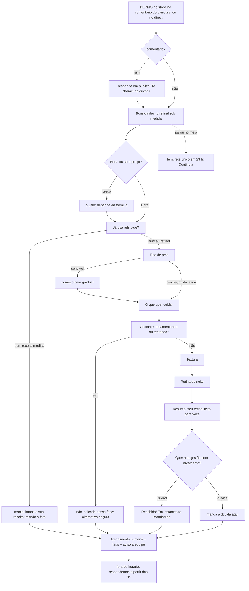

# Fluxo ManyChat · Dermo-day 18/11/2026 (retinal), aprovado pelo Ricardo em 13/11

Roteiro para o Claude no navegador: `python3 -I grade/dermo/fluxo_manychat.py grade/dermo/fluxos/2026-11-18-retinal.json`.
